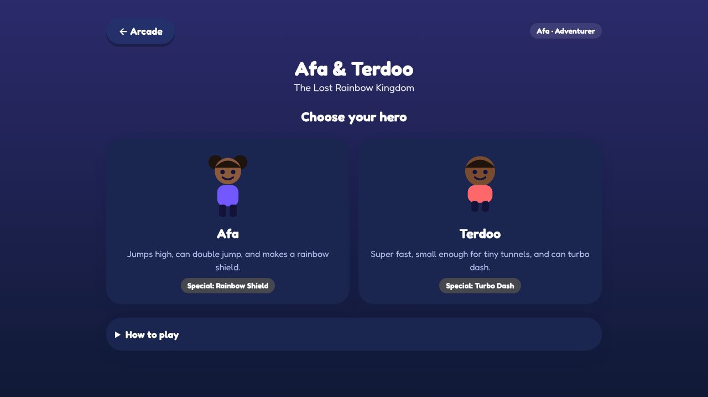
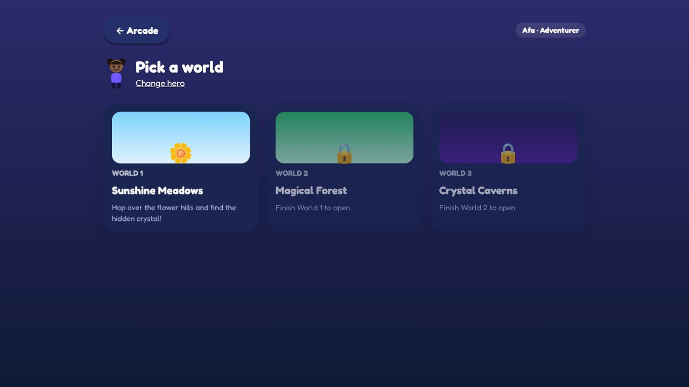
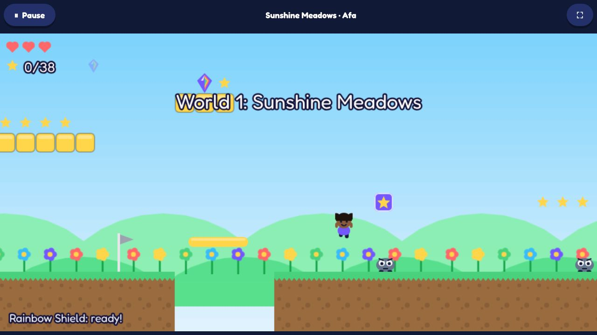
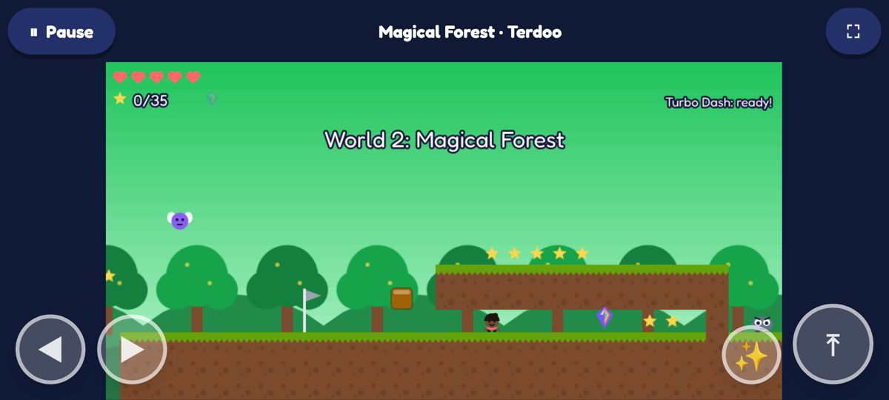
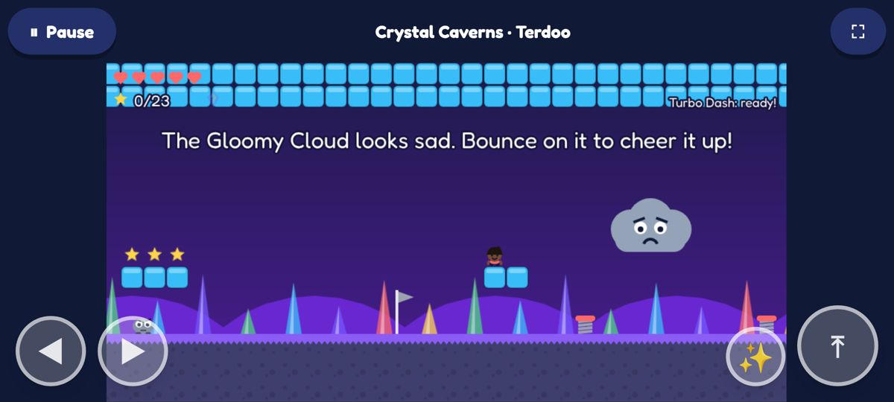
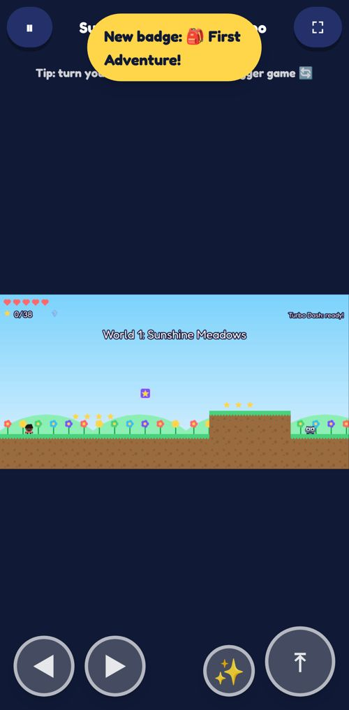

# Phase 2 report: Afa & Terdoo: The Lost Rainbow Kingdom

Date: 2026-11-24. Built after Phase 3 (Retro Console), on top of it.

## 1. Features completed
- **Shared game host** for all original games: lazy loading, pause menu (keep playing, start level again, pick another world, back to the arcade), full screen, automatic pause when the app goes to the background, everything torn down on exit.
- **Shared input**: keyboard (arrows/WASD, Space/Z jump, X/Shift special, Esc/P pause), Gamepad API controllers (stick/d-pad, A jump, B special, Start pause, connect/disconnect notice, pauses if a controller drops), and big multi-touch on-screen buttons on phones and tablets (larger and left-handed layouts follow the player's accessibility settings). A "turn your screen sideways" tip shows in portrait.
- **Two heroes**: Afa (high jump, double jump, Rainbow Shield special) and Terdoo (fast, small enough for tunnels, Turbo Dash special that breaks cracked blocks).
- **Three worlds**: Sunshine Meadows (springs, moving platform, secret sky ledge), Magical Forest (the Tunnel Tree that only Terdoo fits into, up-and-down platform, flying puffs), Crystal Caverns (secret room behind a breakable wall, boss cave).
- **Friendly gameplay**: stars, one rainbow crystal and one secret place per world, surprise blocks with six power-ups (shield, speed boots, super jump, star magnet, extra heart, fairy wings), checkpoints, critters you cheer up by bouncing on them, and a gentle boss (the Gloomy Cloud needs three bounces to smile; then the rainbow gate appears). No game over: running out of hearts says "Great try!" and returns to the last checkpoint.
- **Difficulty per player**: Little Explorer (5 hearts, slower critters, both heroes double jump), Adventurer (3 hearts), Super Hero (3 hearts, faster critters, timer).
- **Results screen** with 1 to 3 stars (finish, most stars, crystal), encouraging message, next world / play again / world map.
- **Saved progress per player** (new `progress` store, database version 3, additive migration): best stars per world, crystals and secrets found, world unlocks, and "Continue" from the last checkpoint.
- **Badges** now unlock: First Adventure, Rainbow Collector, Secret Discoverer, Super Jumper, Teamwork Hero, World Explorer.
- All art is drawn in code and all sounds/music are synthesized: no image or audio files, nothing copied.

## 2. Features verified
In headless Chromium (desktop 1280×720 / 1366×768 and Pixel 7 emulation, portrait and landscape):
- Keyboard moves and jumps the hero; Esc opens the pause menu and "Keep playing" resumes.
- Afa reaches the secret ledge and the rainbow crystal in World 1, walks into the gate, sees the results screen; World 2 unlocks and World 3 stays locked; badges appear on the Achievements page.
- Terdoo walks into the one-tile Tunnel Tree in World 2 and finds the secret and the crystal.
- In World 3 the gate is closed and walking past it does nothing; three real bounces on the Gloomy Cloud open it, and finishing shows the "kingdom is bright again" ending.
- Touch buttons appear on the phone viewport.

## 3. Tests executed and results
- Vitest: 90/90 passed (new: level grids are valid, every world has a start, gate, crystal, secret and checkpoints, surprise blocks match their power-ups, ground objects stand on solid tiles, pits are jumpable or bridged, the tunnel fits Terdoo but not Afa, the boss cave has springs, both heroes can clear a 3-tile ledge, star rating, double-jump rules, world unlocks, best-result merging, resume clearing, badges from progress, catalog marks the game playable).
- Playwright: 16/16 passed (desktop + mobile), including the two new Afa & Terdoo journeys.
- Type check and production build: pass.

## 4. Known issues and limitations
- The game engine (Phaser) adds about 330 KB gzipped, downloaded only when a level starts and cached for offline play.
- Not yet played by a real child, on a physical tablet/phone, Safari or Firefox, or with a real controller. Level difficulty and jump feel may need tuning after real play.
- The browser tests use test-only hooks (`?testhooks=1`) to jump to points in a level; normal play never uses them.
- The game timer shows only on Super Hero; parent playtime limits arrive in Phase 5.
- On phones held upright the game is letterboxed; turning the screen sideways gives the full picture.

## 5. Next recommended milestone
Phase 4: the mini-games (Memory Magic, Math Quest, Word Adventure, Space Explorer, Rainbow Kart).

## Screenshots
| | |
|---|---|
|  |  |
|  |  |
|  |  |
