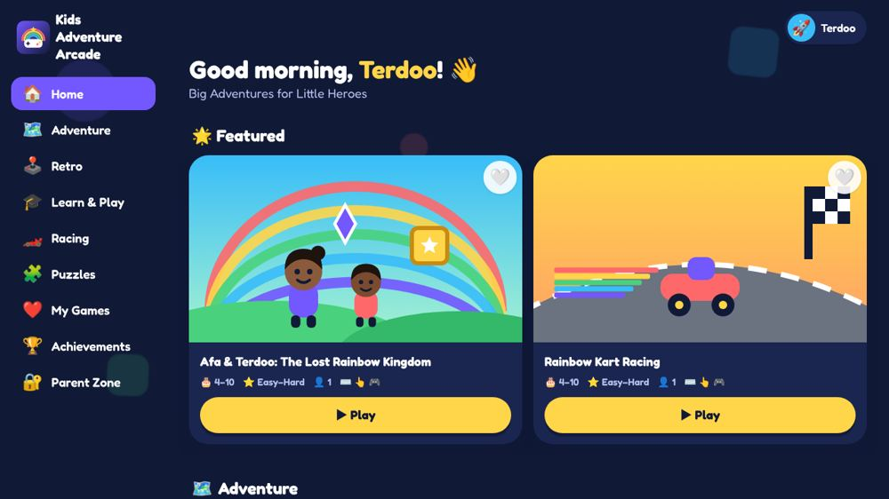
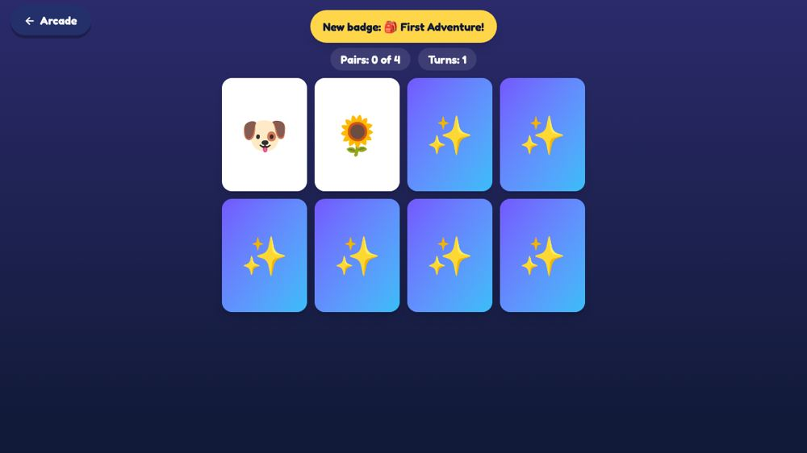
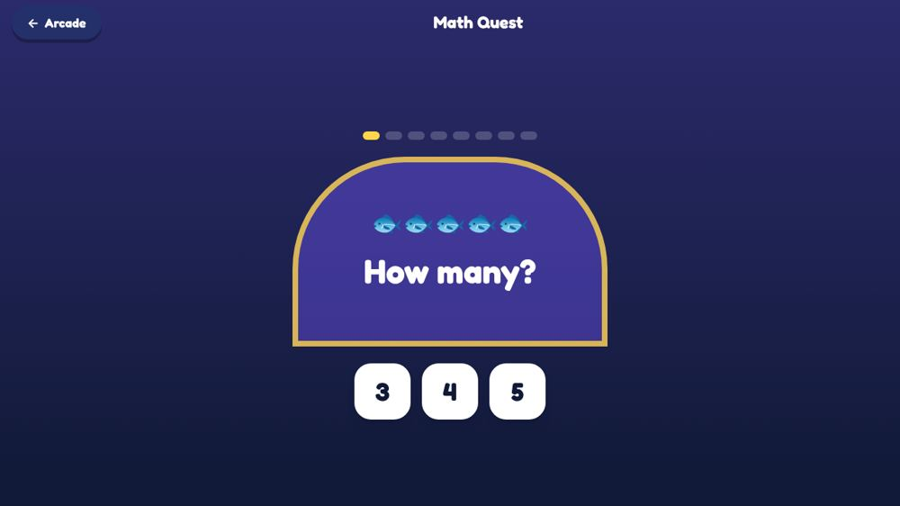
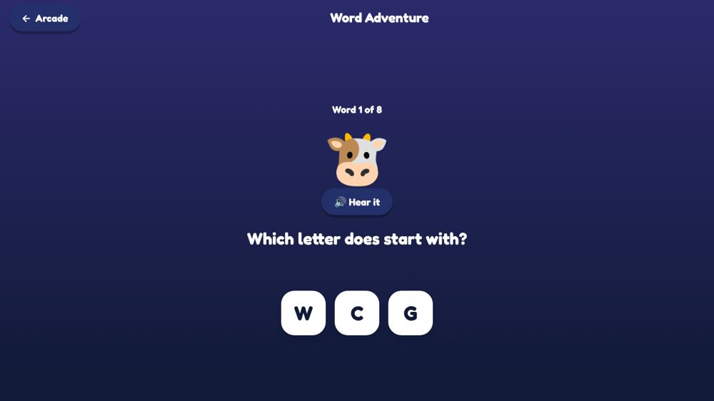
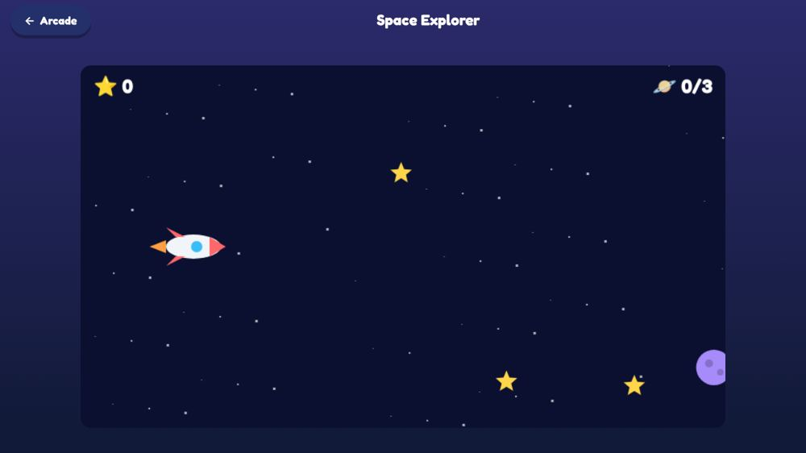
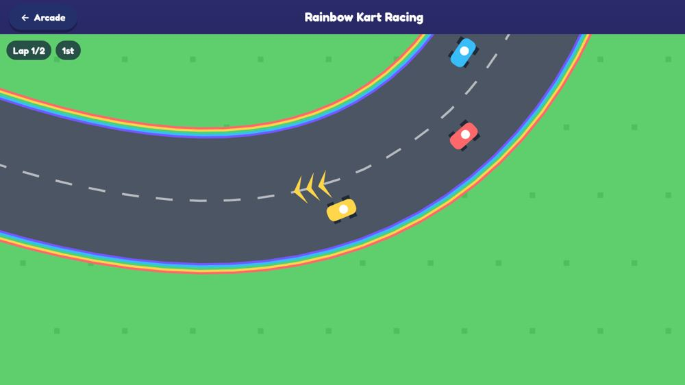
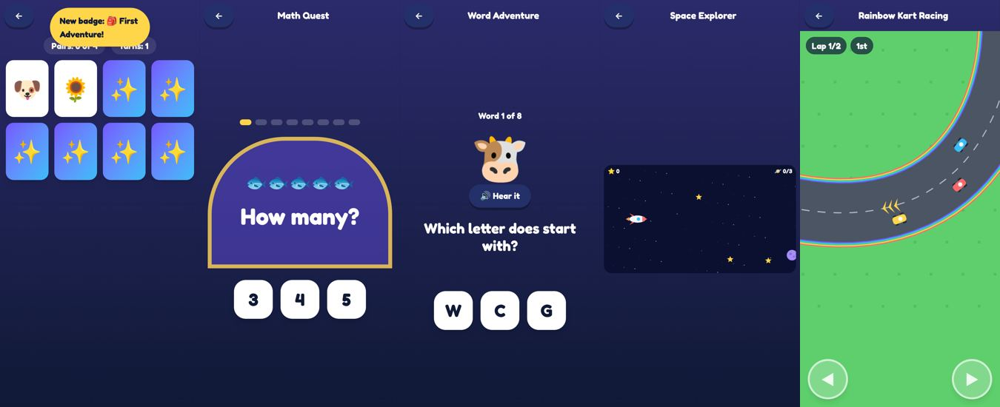

# Phase 4 report: mini-games

Date: 2026-11-25.

## 1. Features completed
All five remaining games from the roadmap can now be played. Each one is original, works offline, and is loaded only when it is opened.

- **Memory Magic** (ages 3–10): flip cards to find matching pairs. Little Explorer has 4 pairs, Adventurer 6 and Super Hero 8. There is a 1-player mode and a 2-player mode with turns and scores. The cards are big buttons, and a screen reader announces each card.
- **Math Quest** (ages 4–9): open 8 magic doors by picking one of 3 big answers.
  - Little Explorer: counting pictures, and adding within 5 with a picture hint.
  - Adventurer: adding and taking away within 10.
  - Super Hero: numbers within 20, plus small times tables.
  - A wrong answer just greys out that choice ("Nice try!").
- **Word Adventure** (ages 3–8): Little Explorer picks the first letter of a picture. Adventurer spells the word with letter tiles, and a hint shows the next letter if a wrong tile is tapped. "🔊 Hear it" uses the device's own voice when it has one.
- **Space Explorer** (ages 4–10): fly a rocket with the arrow keys or by touching where to go. Collect stars and visit Mars, Jupiter and Saturn, each with a simple true fact. Bumping a space rock only slows the rocket down for a moment.
- **Rainbow Kart Racing** (ages 4–10): the kart drives by itself and you steer with the arrows or two big buttons. There are boost pads and two friendly rivals.
  - Little Explorer: 2 laps, slower rivals, and strong steering help.
  - Super Hero: 3 laps, fast rivals, and no steering help.
  - Every finish is celebrated. Driving off the road only slows the kart down.
- **Shared mini-game kit**: page frame, results card (always 1–3 stars), sounds made in code, best results saved for each player, and badges. New badges that can now be earned: Puzzle Master, Math Explorer and Racing Champion.
- **Game screens load by themselves.** Each game's catalog entry now has a `screen`, so the play page loads any game without being edited.

## 2. Features verified
Tested in headless Chromium at desktop (1280×720 / 1366×768) and Pixel 7 sizes. Each journey below was played for real in the browser:
- **Memory Magic:** found every pair in the fewest turns (3 stars) and earned the badge.
- **Math Quest:** opened all 8 doors.
- **Word Adventure, Little Explorer:** a wrong letter is greyed out, then the round finishes.
- **Word Adventure, Adventurer:** spelled 8 words with the letter tiles.
- **Space Explorer:** the rocket moves with the keyboard, and the trip ends after all three planets.
- **Rainbow Kart:** the kart drives, the lap counter shows, the race finishes, and the badge is earned.

## 3. Tests executed and results
- **Vitest: 112 of 112 passed.** New tests cover:
  - memory deals and star ratings
  - math answers are always correct, never negative, with 3 different choices, and small numbers for little ones
  - letter and spelling rounds
  - rocket movement, planets and the end of a trip
  - the kart track, a full race finished with steering help, slowing down off the road
  - every game screen loads
- **Playwright: 28 of 28 passed** on desktop and mobile, including 6 new mini-game journeys.
- **Type check and production build:** pass.

## 4. Known issues and limitations
- No child has played these yet. The pacing (rival speed, star counts, number ranges) may need tuning.
- "Hear it" depends on the device having a voice installed. Some browsers have none offline.
- Two-player mode is in Memory Magic only. Racing is single-player for now, and the catalog now says so.
- On phones held upright, Space Explorer and the race view are small. Turning the phone sideways is better.
- The tests jump straight to the end of a race or trip using hooks that only exist in tests.

## 5. Next recommended milestone
Phase 5: parent playtime limits and break reminders, a fuller set of achievements, controller and touch-control customization in the Parent Zone, and per-game settings.

## Screenshots
| | |
|---|---|
|  |  |
|  |  |
|  |  |

