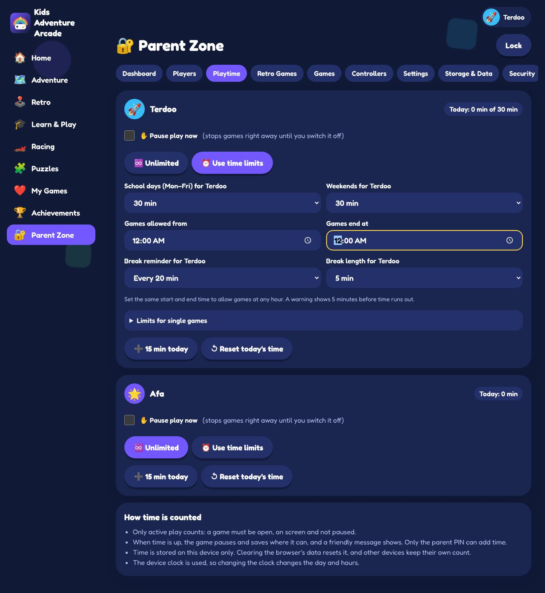
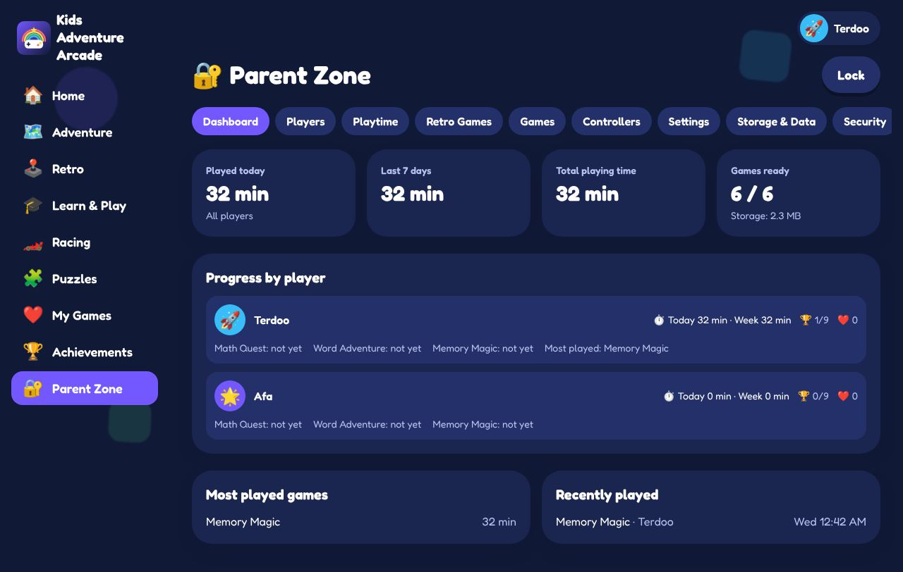
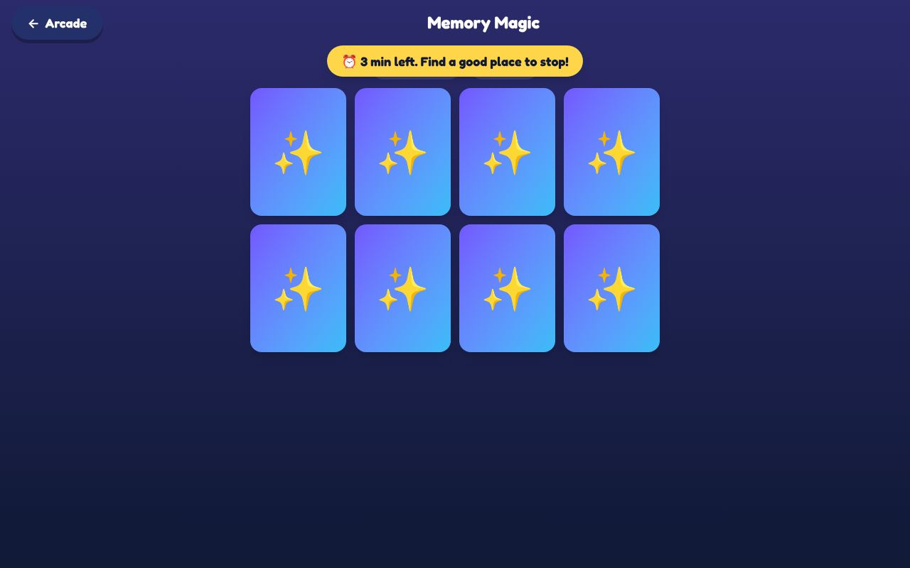
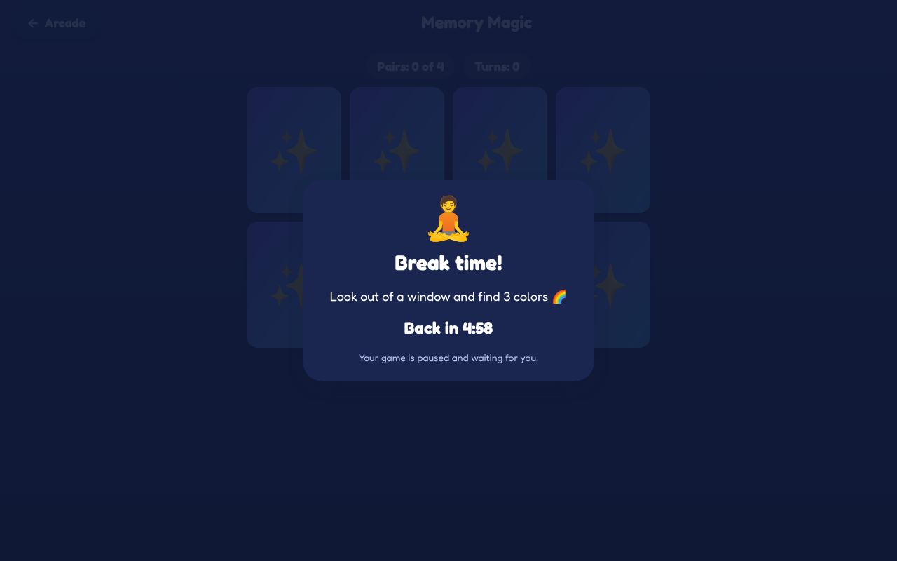
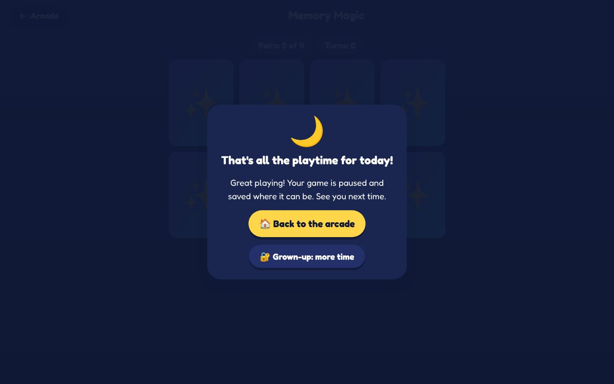
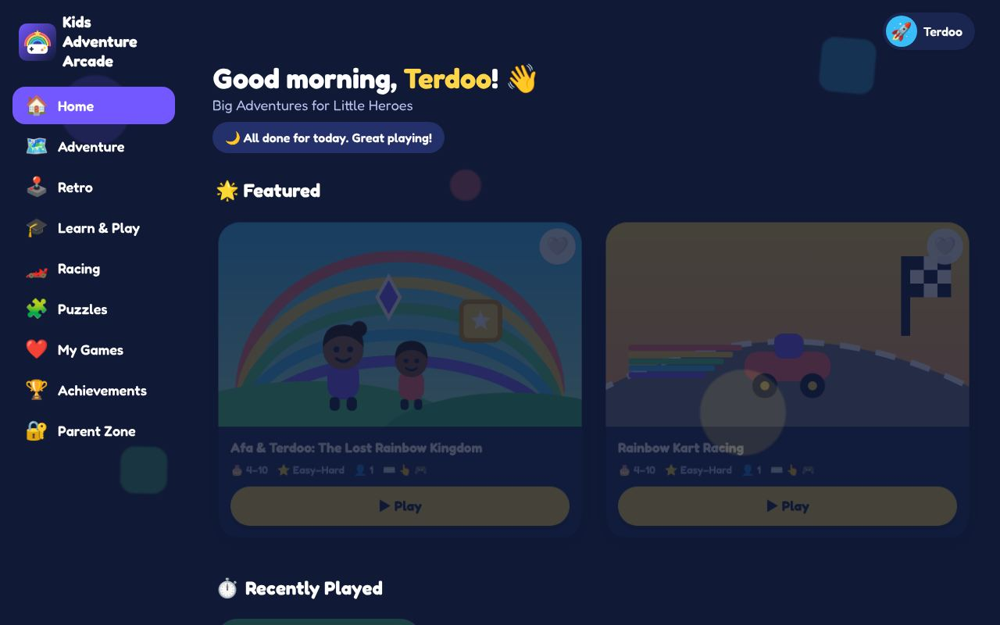
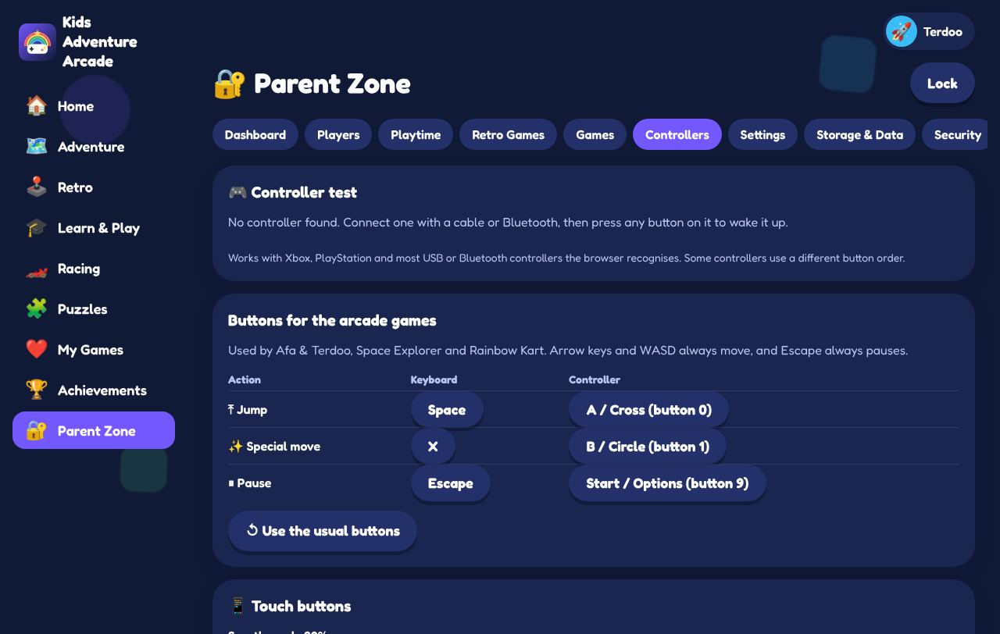
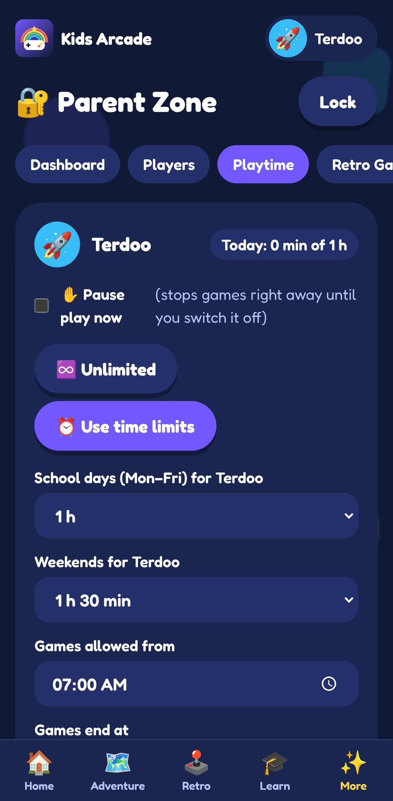

# Phase 5 report: family gaming features

Date: 2026-11-25.

## 1. Features completed
- **Playtime limits (Parent Zone → Playtime), set per player:**
  - **Unlimited mode** is the default. Time is still counted for the dashboard.
  - **Daily limits**, with separate amounts for school days (Monday–Friday) and weekends.
  - **Permitted hours**, for example 07:00–20:00. Windows that cross midnight work. Setting the same start and end time allows any hour.
  - **Break reminders** after 15–60 minutes of play, lasting 2–15 minutes. A rest away from games of at least the break length also counts as a break.
  - **Limits for single games**, for example Rainbow Kart for 15 minutes a day.
  - **"Pause play now"** stops games right away until a parent switches it off.
  - **Parent tools:** "+15 min today" and "Reset today's time".
- **Fair counting:** only active play counts. A game must be open, on screen and not paused, and parent test launches don't count. Time is saved every few seconds and when the app is hidden, so it survives a refresh or a browser restart.
- **What the child sees:**
  - A warning 5 minutes before time runs out, including before the end of the permitted hours.
  - A break screen with a countdown and a stretch idea.
  - At the end, a friendly "That's all the playtime for today!" screen.
  - The game pauses first. The Retro Console also saves to its automatic slot.
  - Only the parent PIN can add 10, 15 or 30 minutes, with the same lockout as the Parent Zone.
  - The home screen shows the time left today when limits are on.
- **Parent dashboard:** time played today, in the last 7 days and in total; most played games; recently played games with the player's name; and progress for each player (time, badges, favorites, best stars in Math Quest, Word Adventure and Memory Magic, most played game).
- **Controller customization (Parent Zone → Controllers):**
  - A live controller test shows connected controllers, pressed buttons, sticks, and connect or disconnect messages.
  - Parents can change the keyboard key and controller button for Jump, Special move and Pause. Arrow keys and WASD always move, and Escape always pauses, so these can't be taken away.
  - Touch buttons have a see-through level and a vibration switch. Bigger buttons and the left-handed layout are still set for each player.
- **Data:**
  - A new `playtime` store (database version 4), added as a migration so existing players, saves and retro games are kept.
  - Settings saved by older versions get the new control fields filled in.
  - Playtime is deleted with the player and included in the data export.
- **Retro Console fixes from your report:**
  - An SNES game stayed on "Loading the console…" inside Replit's preview, with "replit.com refused to connect". The console page used to open as a separate page inside a frame, and Replit's preview redirects such page loads to replit.com, which can't be shown in a frame. The console page is now fetched like any other file and opened from memory, so no separate page load happens. A browser test now refuses those page loads the same way and checks that the console still starts.
  - If the console page doesn't answer within 30 seconds, a clear message replaces the endless "Loading".
  - **Zipped games:** a `.zip` holding one game file can now be imported. It is unzipped on the device and nothing is uploaded. Zips with no matching file, several games, a password or damage get a plain explanation.
- **Bugs found by CI and fixed:** quick changes in a row on the Playtime or Controllers pages could undo each other, and a fast double tap on "Add demo players" could add them twice.
- **Already in place and checked again:** favorites (heart on game cards, "My Favorites" row), 9 positive badges with no streaks or penalties, and the 2-player mode in Memory Magic.

## 2. Features verified
Checked in headless Chromium at desktop (1280×800 and 1366×768) and Pixel 7 sizes:
- **Limits:** set limits, see the time left on the home screen, see the 5-minute warning, and reach the stop screen.
- **PIN:** a wrong PIN is refused. The right PIN adds 10 minutes, and that survives a reload.
- **Dashboard:** shows the time and the most played game.
- **Breaks:** a break starts in Space Explorer after 15 minutes, the rocket can't move during it, and play goes on after it.
- **Pause play now:** blocks a game and the home screen says why. Switching it off allows play again.
- **Controllers:** the live test, capturing a new controller button and keyboard key, refusing a reserved key, saving across visits, and resetting to the usual buttons.

## 3. Tests executed and results
- **Vitest: 128 of 128 passed.** New tests cover zip reading (compressed, stored, and helpful errors), weekday and weekend allowances, the warning, hours (including across midnight and bedtime countdown), per-game caps, extensions, breaks and rests, summaries, storage and deletion, migrating old settings, and custom key and button mapping.
- **Playwright: 38 of 38 passed** on desktop and mobile, including 4 new family journeys (8 runs). The new journeys also passed 32 of 32 when repeated 4 times in parallel.
- **Type check and production build:** pass.
- **Fixed during testing:** the test-only playtime hook could appear before the day's saved time had loaded, which made one run flaky. It now appears after loading.

## 4. Known issues and limitations
- **Local only.** Time counting and limits live in this browser. Clearing site data resets them, other devices keep separate counts, and changing the device clock changes the day and hours. Two tabs open at once each count their own game. The Playtime page explains this to parents.
- **No idle detection.** A game left open on screen and not paused counts as playing. Games already pause when the app is hidden.
- **Controller tests used a simulated controller in the browser.** No real Xbox, PlayStation or Bluetooth controller was tested, and no real phone or iPhone was used.
- **Button mapping applies to the original games.** The Retro Console keeps its own fixed layout.
- **Fast-forwarded time in tests.** The browser tests jump time forward with a hook that only exists with `?testhooks=1`, instead of waiting real minutes. The screenshots below let the real clock start the break.

## 5. Next recommended milestone
Phase 6: offline and caching review, performance, an accessibility audit, cross-browser checks, phone refinements, and the 57 npm audit warnings in development tools.

## Screenshots
| | |
|---|---|
|  |  |
|  |  |
|  |  |
|  |  |
